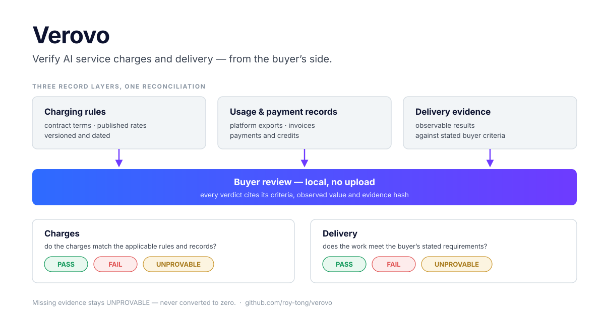

# Verovo


**Verify AI service charges and delivery — from the buyer’s side.**

Verovo helps teams connect applicable billing rules, usage and payment records,
delivery evidence and business requirements. Use the results for reconciliation,
payment, acceptance, remediation and renewal.

<p align="center">
  
</p>

[Website](https://roy-tong.github.io/verovo/) · [中文](README.zh-CN.md) ·
[Product definition](docs/product-definition.md) · [Buyer task guide](docs/buyer-review.md)

## Two workflows, one buyer decision

| Workflow | Question | Useful next step |
|---|---|---|
| **Charge review** | Do the charges match the applicable rules and records? | Reconcile, pay, request evidence or ask the supplier to review a difference |
| **Delivery review** | Does the work meet the buyer’s stated requirements? | Accept, request remediation, adjust scope or decide on renewal |

Run either workflow independently or combine them. Correct charges do not establish
successful delivery; poor delivery does not automatically establish incorrect billing.
Missing evidence remains **UNPROVABLE**.

Our users are business and engineering owners accountable for AI spending or results,
with finance and procurement as collaborators. AI support is an initial application
scenario. Coding agents, automation platforms, tools/APIs and model services belong to
the wider scope; coverage is verified task by task.

## Try a buyer review locally

The new `review` command is a **main-branch preview**, not part of the v0.9.0 tag.
Python 3.9+, standard library only:

```bash
git clone https://github.com/roy-tong/verovo.git
cd verovo
python3 healthcheck/verovo review --sample --html buyer-review.html --json buyer-review.json
```

The synthetic example returns **charges: PASS**, **delivery: FAIL**, and one missing
delivery observation as **UNPROVABLE**. Open `buyer-review.html` to inspect both lanes,
criteria, rule references, observed values and evidence hashes. Every report carries
three **conclusion levels**, kept separate: Level 1 rule consistency (what the run
establishes), Level 2 evidence credibility (rule applicability, source truth, coverage —
reported as not established when absent), Level 3 the buyer business decision (outside
the tool). The six operating stages — Intake → Source Check → Rule Resolution →
Reconciliation → Delivery Assessment → Buyer Decision — map each step to a command in
[docs/review-method/buyer-review-stages.md](docs/review-method/buyer-review-stages.md).

[View the synthetic report](https://roy-tong.github.io/verovo/examples/buyer-review.html).
Agent hosts can call the same review read-only via MCP (`verovo-mcp`: `verovo_review`,
`verovo_review_template`, `verovo_recount`; no write or submit actions exposed).
To review your own task, copy the [task and observation examples](healthcheck/verovo_healthcheck/demo/buyer-review.json)
and follow the [input guide](docs/buyer-review.md). Checks compare supplied criteria
with values in local JSON files. A person must confirm rule applicability and source
truth; the tool does not infer contract terms or judge arbitrary AI output quality.

## Re-count a bill in 60 seconds

For the existing tagged CLI:

```bash
python3 -m pip install "git+https://github.com/roy-tong/verovo@v0.9.0#subdirectory=healthcheck"
verovo recount --sample
```

The `verovo` PyPI project is not yet published (checked 2026-10-31). The Git tag
installs existing commands; use the main checkout above for the new buyer review.
CLI and Provider SDK releases have separate version numbers.

`prepare` maps supported exports; `recount` applies a selected vendor rule set;
`dispute` organizes supported differences; `recovery` records supplier responses
and realized corrections separately. A rule-priced finding is not recovered money.
[Recount examples](examples/showcase/README.md) · [Periodic reconciliation](RECONCILE.md)

## What is available today

| Capability | Current boundary |
|---|---|
| Buyer review (main preview) | Explicit charge/delivery criteria, local JSON evidence, separate results and offline HTML/JSON; no universal contract parser |
| Supported billing recounts | Selected export formats and versioned rules; applicability must be reviewed |
| Buyer Ledger | Local tool-bill processing and 26 catalog entries; cataloged does not mean connected or validated on real customer bills |
| Developer diagnostics | Local coding-agent log checks, measurement conformance and regression fixtures |
| Human buyer review | Scope and fees discussed for a concrete task; commercial acceptance and repeat purchase remain under validation |

[Buyer Ledger](buyer-ledger/README.md) · [Coverage limits](buyer-ledger/REVIEW-20261029.md) ·
[Developer CLI](healthcheck/README.md) · [Conformance](conformance/pack/README.md)

## Start with a real task

[Describe a billing, acceptance or renewal task](https://roy-tong.github.io/verovo/first-look.html#contact):
name the service, account or task, decision date, available record types and owner.
You can request delivery review without first finding a billing discrepancy.

Free measurement lane / 免费测量通道: bring 20–100 sanitized rows to
[issue #6](https://github.com/roy-tong/verovo/issues/6) or the
[website form](https://roy-tong.github.io/verovo/services.html) —
免费：带 20–100 行脱敏数据提交到 issue #6 或官网表单。

Providers reviewing upstream spend are buyers in that transaction. Provider-side
work for downstream billing is an extension triggered by a concrete customer dispute,
revenue discrepancy or procurement requirement. It does not redefine the buyer focus.

The existing [free measurement runs](https://roy-tong.github.io/verovo/services.html)
retain their separate sample-based scope. No fixed enterprise price or recovery
promise is published. Scope and any fee are agreed before commissioned work.

## Evidence and contribution

Local CLI commands do not upload data. Optional GitHub-hosted workflows upload to
GitHub and require a private repository; do not put private bills in public issues.
Synthetic fixtures and test results establish engineering behavior, not customer
adoption, economic recovery or paid demand.

Launch case cards — every number sourced and dated:
[tokendash #37](docs/launch/case-tokendash-37.md) (one message billed as three),
[claude-hud #758](docs/launch/case-claude-hud-758.md) (1-hour cache writes at the
5-minute rate), [VibeMirror-coder-001](docs/launch/case-vibemirror-coder-001.md)
(an independent re-measurement through the free lane). Index and walkthrough
images: [docs/launch](docs/launch/README.md).

[CI](https://github.com/roy-tong/verovo/actions/workflows/conformance.yml) ·
[Claims and reproductions](https://roy-tong.github.io/verovo/claims.html) ·
[Roadmap](ROADMAP.md) · [Contributing](CONTRIBUTING.md) · [Agent instructions](AGENTS.md)

The standard, SDK, rules and reusable checks support these workflows and remain
open source. [MIT license](LICENSE).
